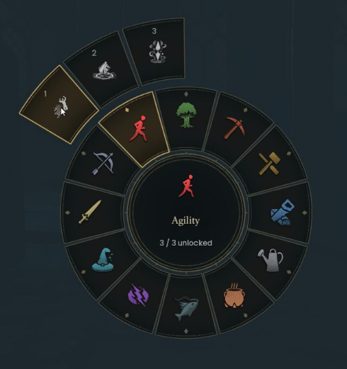

# BetterSpellWheel

A skill-based spell wheel for **RuneScape: Dragonwilds**. Press **Q**, hover a skill,
then move outward to choose a spell. Or use your controller to choose a skill,
browse its spells, and cast without reaching for the mouse.

## Your skills. Your magic.

- **39 spells across 12 skills**, grouped using the game's actual progression data.
- **A clean, centred wheel:** the hovered spell's name, tool requirement and rune costs
  appear in the middle, with each rune count **green** when you carry enough and **red**
  when you don't. Its description sits in a tooltip bar under the wheel.
- **Live cooldowns** synced from the game, including cooldowns started before you loaded
  in and perks that shorten them. The game always decides whether a spell can be cast,
  so mods that remove cooldowns (such as Utility Spells - No Cooldowns) keep working.
  `ShowCooldowns=false` in `config.txt` hides the timers.
- **Keep moving:** walk while the wheel is open.
- **Controller navigation:** right stick or D-pad, with matching button hints.
- **Normal game rules:** your unlocks, rune requirements and targeting still apply.
  Saved spellbook assignments are preserved.

## Download and install

**0.4.4 · Windows · Keyboard and mouse (controller: beta)**

| Download | Installation |
| --- | --- |
| [Easy installer (.exe)](https://github.com/Proxify/rsdw-betterspellwheel/releases/download/v0.4.6/BetterSpellWheel-0.4.6-setup.exe) | Close the game and run setup. It finds your Steam installation and installs UE4SS if needed. |
| [Manual install (.zip)](https://github.com/Proxify/rsdw-betterspellwheel/releases/download/v0.4.6/BetterSpellWheel-0.4.6.zip) | Follow the included `INSTALL.txt`. Requires Dragonwilds-compatible UE4SS already installed. |

The EXE is a separate download. Setup preserves other mods and your existing
settings on update; run it again to update or uninstall. The installer is unsigned.

Install on the client where you want the new wheel. PlayerTrading and RuneSchema
are not dependencies, and there is no server component.

**Coming from SpellBranches?** Close the game and remove its old mod folder and
`SpellBranches : 1` entry from `mods.txt` before installing BetterSpellWheel.
Keep only one wheel enabled.

[Full installation and troubleshooting guide](INSTALL.txt) · [Release notes](CHANGELOG.md)

## Controls

| Input | Action |
| --- | --- |
| Q / your normal spell-wheel binding | Open the wheel |
| Q / Escape | Close without selecting |
| Hover an inner skill icon | Reveal that skill's spells |
| Move outward + left-click | Select a spell, then use the game's normal casting controls |
| Return to the inner ring | Change skills |
| Right-click | Go back to skill selection |
| WASD | Keep walking while the wheel is open |

With a controller:

| Input | Action |
| --- | --- |
| Y / Triangle (or your normal binding) | Open or close |
| Right stick | Point at a skill; after choosing it, point straight at a spell |
| Left stick | Keep walking |
| D-pad | Browse skills or spells, with hold-to-repeat |
| A / Cross | Choose the skill, then select its highlighted spell |
| B / Circle | Back to skills; press again to close |
| X / Square | Switch to the game's emote wheel |
| LB / RB or L1 / R1 | Change pages when a skill has more than six spells |

Release the stick after choosing a skill before pointing at its spells. Once a spell
is selected, use the game's normal targeting controls (RT / R2 to confirm, LT / L2 to
cancel). Moving the mouse switches back to mouse navigation. `ControllerPrompts=PlayStation`
in `config.txt` overrides Xbox hints when using Steam Input.

Locked spells remain visible with their required level. Hovering alone never casts.
To hide cooldown timers, set `ShowCooldowns=false` in `config.txt`.
`PerfLog=true` writes the mod's per-second cost to UE4SS.log (troubleshooting only).
To disable the mod, set `Enabled=false` in `config.txt` and restart the game.

## Credits

Version 0.4.0 brings in improvements first made in a community fork by jackisace
(centred layout, rune counts, cooldown timers, movement while open, right-stick
navigation), reviewed and adapted here.

## Compatibility

Tested on **Dragonwilds 1.0 / UE 5.6**, Windows. 0.4.0 was tested in-game at
2560×1600 with mouse and keyboard in a solo world (0.4.1's self-drawn wheel art was
checked in-game too): instant and aimed casts, cancel,
cooldowns (including ones started before loading in), rune colours, walking while
open, and saved spellbook slots.

0.4.2 was checked in-game with and without Utility Spells - No Cooldowns (see
`tests/live-cooldowns-0.4.2.txt`). 0.4.3's performance and cooldown changes were
measured and checked in-game (`tests/live-perf-0.4.3.txt`, `docs/COOLDOWN-VALIDATION.md`).

Not yet verified for 0.4.0: gamepads (the new right-stick and emote hand-off
behaviour), playing on a dedicated server, ultrawide displays and other spell-wheel
mods. 0.3.0's controller flow was tested with a virtual Xbox controller.

## Development

Run `python tests/run.py` with Python and `lupa` installed. The wheel artwork is drawn
by the mod itself on first launch (`Scripts/art.lua`), so releases ship no image files. Game icons load from your installed game;
no game textures are redistributed.

Build the manual ZIP with `python tools/package.py`. Follow the
[installer build guide](installer/README.md) for the separate setup EXE and Windows
validation. Every release includes both files; developer consoles, tests and
runtime data are excluded from the downloads.

## License

BetterSpellWheel is © 2026 Proxify, licensed under the [Apache License 2.0](LICENSE).
You may use, modify and share it, but any redistribution or derivative work
(forks, ports, modified builds, mods that include its code or artwork) must keep
the [NOTICE](NOTICE) file and credit the original:
"Based on BetterSpellWheel by Proxify — https://github.com/Proxify/rsdw-betterspellwheel".

## Responsive navigation in 0.4.4

Icons stay resident and navigation responds in the current game frame, without selection delays or fades. See [validation](docs/INSTANT-VALIDATION.md) for measurements and coverage.
