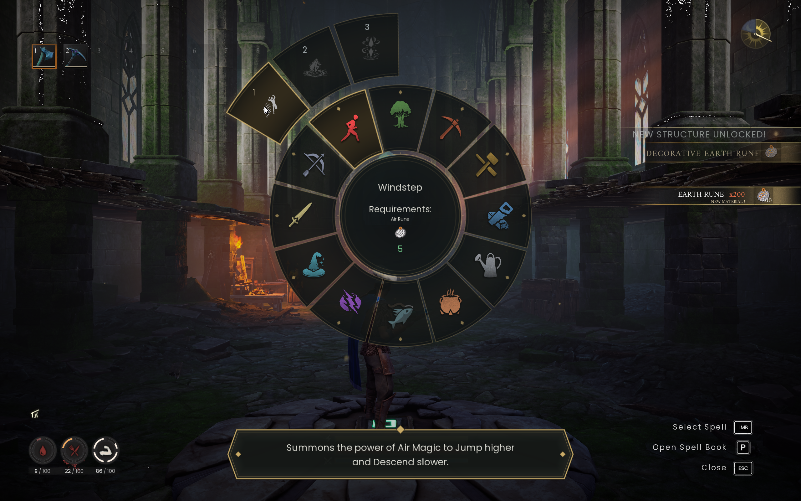
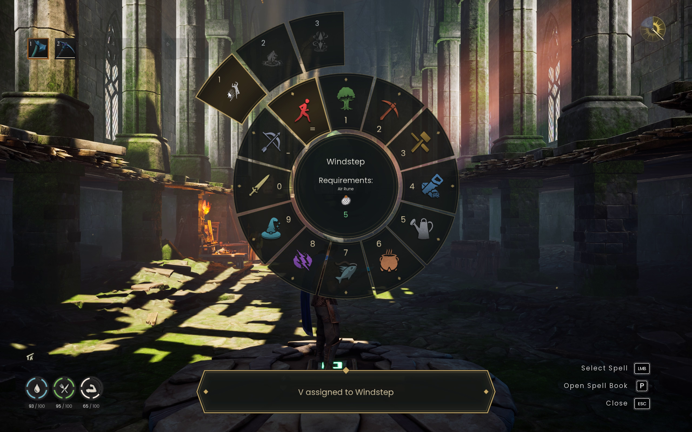
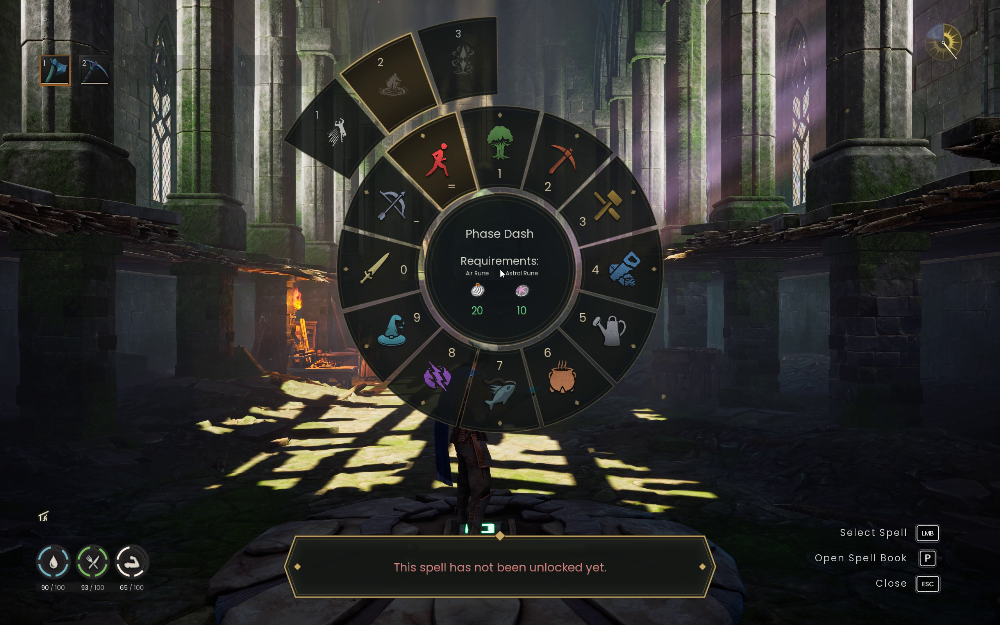

# Keyboard shortcuts: implementation and acceptance

Source base: main 4b256fdbc4fcc71ec2bf19fe034de66d3ec89e86 (0.4.7).
Proposal credit: nachobenedetto, PR #9. Implemented independently against the
existing wheel adapter; no PR #9 code or claimed native evidence is adopted.

Player task: reach a frequently used utility spell with fewer pointer movements.
Primary actions: number-row skill then spell selection; bind/cast a named slot.
Both are opt-in. Preserve native unlock/rune/equipment/cooldown checks, targeting,
cancel, the 48 saved native spell slots, mouse/controller handoff, input return,
world rebinding, settings and upgrade preservation. No new always-visible HUD.

Frozen self-review rubric (1–10; 9 is the design target, not objective acceptance):
hierarchy/clarity, readability, spacing/density, contrast, component consistency,
interaction/input, resolution/scale. Use the existing wheel as the reference;
no website/phone rubric applies. Score actual gameplay images after implementation.
Budget: at most eight candidates or 90 minutes of design iteration. No independent
review council is authorized. Native and safety checks remain separate gates.

Baseline and candidate: SudoBlade, sarah/njoy112, TradeTester, Standard TRADE_TEST,
2560x1600, native UI scale 1.481, game build 26574764, UE4SS 3.0.1 beta
f6d5f942. Saved and Mods were backed up by SHA-256 before launching. The TEST
fixture unlocks Windstep, Axtral Projection and Summon Shelter and supplies
200 Air/Astral/Earth runes; those fixture changes are restored after testing.

Reload loop: syntax/offline checks → sync the complete Scripts set to the owned
BSW test install → compare source hashes → game-thread dev-console dofile(main)
while the wheel is closed and no spell is pending → native key tests. Existing
dev-console/current-module guards are used, never UE4SS Ctrl+R. Record PID and
repeat reloads, then cold-start the final source. A packaged release is not part
of this task, but shared manifest/config preservation must remain correct.

Acceptance checklist:
- Defaults retain the existing input query counts and closed-wheel behavior.
- Number keys are consumed only with quick pick enabled and the wheel open.
- Holding a key cannot choose a skill and cast a spell in one press.
- Mouse motion/controller activity takes over predictably; timeout/reopen reset.
- Slot assignments use stable catalogue IDs, persist across reload/rejoin, and
  never save engine objects or localized display names as identity.
- No new RegisterKeyBind callback, independent loop, hook or HUD generation.
- Slot presses are ignored in menus/chat/targeting; locked/native-refused casts
  preserve slots and return input correctly. Configuration conflicts fail safely.
- Baseline suites plus focused tests exercise old/controlled-broken behavior.
- Real footage and screenshots go directly into the draft PR; missing coverage
  stays explicit. Credit/link the original proposal and post findings there.

Final tested runtime: `06b0bede0cbe44382597f128d317f6111e9b4eab`.
All 11 installed Lua files match the working source by SHA-256. Later commits
add documentation/media only. No version bump, release or production deployment.

## Results, 2026-11-14

| Check | Result and scope |
| --- | --- |
| Full `python tests/run.py` | PASS, including shortcut configuration/persistence, input, native-adapter mocks, catalogue, view/performance and artwork suites. |
| Disabled features | Existing key-query counts retained. Two configured slot keys add 8 queries closed / 20 open, including modifiers; no new loop or key-thread callback. This is a call-count check, not an FPS benchmark. |
| First use | Cold process 21072: Z casts Windstep before Q has ever opened the wheel. Delayed Q opening after several minutes remains functional. |
| Quick pick | Real Q, held equals and 1 select Agility/Windstep; holding equals does not also cast. Four-second timeout observed; ordinary mouse hover still works. |
| Assignment | Real mouse hover plus V displays the saved Windstep assignment. Closed-wheel V casts. Stable ID survives three integrated reloads. Z assignment survived process restart. |
| Native rules | Locked Phase Dash remains refused. Axtral Projection enters native aiming; Z is ignored there, Escape cancels, gameplay input returns. Menu Z/V leave native cast timestamps unchanged. |
| Native slots | All 48 saved spell identities remain byte-for-byte equal as recorded FNames after casting, aiming/cancel, cold starts and reloads. |
| Reload/lifetime | Three final-source integrated reloads in PID 21072 retire the old module and retain assignments; subsequent native opening/closing works. No Ctrl+R. Cold-start acceptance is separate and passed above. |
| Windows installer | Final TEST package: install/update/repeat/uninstall, custom config and assignment preservation, shared dependencies, both layouts, invalid/conflicting/legacy/junction targets, and running-game refusal PASS on SudoBlade. |
| Package | Shared production manifest; ZIP allowlist PASS, only `.lua` and `.txt`. No dev console, tests, media or runtime data. TEST installer reuses the verified unchanged v0.4.7 installer stub/dependencies; it is not a released version. |
| Capture | Uninterrupted 180-second real desktop take, foreground/PID guarded. Health monitor reads only: minimum 110, no sample below 80. 53.52-second narrated 1080p export fully decodes. |

The first-use regression test fails when the viewport-layout fix is removed.
The label test retires temporary font donors before drawing/reopening and detects
late donor access. These checks exercise the failure conditions rather than only
checking that the implementation imports.

Native iteration found and corrected two defects in the independent candidate:
the first closed-wheel cast needed layout before pointer placement, and labels
needed construction before temporary font donors could expire. One earlier
candidate crashed in UE4SS while opening after a delay; the donor-lifetime cause
is an inference, not a proven native stack diagnosis. The final source passed
delayed opening, cold first use and repeated reloads. The failed run remains in
private evidence and is not presented as a successful take.

## Visual self-review

This is a single-session self-review, not independent consensus. The existing
wheel is the fixed reference. Baseline and candidate use the same character,
World and viewport; time of day, health and fixture notifications differ, so
these are layout comparisons rather than perfectly matched visual frames.

| Frozen category | Baseline | Candidate | Visible finding |
| --- | ---: | ---: | --- |
| Hierarchy/clarity | 8 | 8 | Existing radial hierarchy retained; two-stage numbered input still needs discovery. |
| Typography/readability | 8 | 8 | Numbers fit native wedges; multi-line hints can be dense. |
| Spacing/density | 9 | 9 | No extra persistent HUD; assignment feedback uses the existing tooltip. |
| Color/contrast | 8 | 8 | Native gold styling retained; small numbers have less contrast over translucent dark wedges. |
| Component consistency | 9 | 9 | Existing labels, native tooltip and refusal colors reused. |
| Interaction/input | 8 | 8 | Quick and saved-key paths work; no new in-game key-binding settings surface. |
| Other resolutions/scales | — | — | Only 2560x1600 / 1.481 native scale verified. |

Early candidate feedback overlapped the lower HUD; moving it into the existing
tooltip corrected that in fresh native captures. The next behavioral passes
fixed first-use layout and late label construction. Final screenshots show the
assignment, locked state and aiming flow. No additional aesthetic rounds were
run after these functional corrections. The 9/10 target is not claimed achieved.

## Remaining acceptance

- Simultaneous two-player gameplay/video, dedicated-server acceptance, and the
  current Together combination are **not verified**. The second desktop on
  nJoyDesk stayed locked; its documented reconnect returned Windows error 1326
  and the existing reconnect secret was unavailable. No second view is simulated.
- Controller hardware, alternate layouts/localization, other game resolutions,
  cooldown-altering mods and complete native cost/refusal combinations need checks.
  Mocked refusal coverage does not replace these native checks.
- No comparative native FPS claim. Capture used 30 fps output with observed
  capture-rate limitations; that does not prove 30 fps gameplay or guaranteed 60.
- The source PR remains **draft**, unapproved and unmerged.

## Evidence

[Narrated showcase (MP4)](evidence/shortcuts/shortcuts-showcase.mp4) ·
[continuous raw take, compressed web copy (MP4)](evidence/shortcuts/shortcuts-raw-take.mp4) ·
[media provenance and shot list](evidence/shortcuts/README.md).

