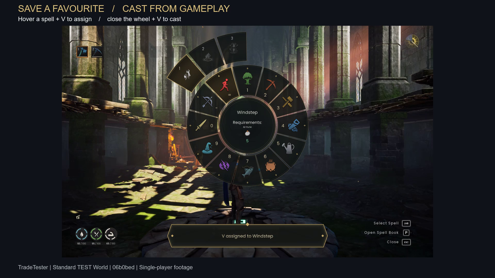

# Shortcut gameplay evidence

Real single-player TEST footage; no second-player claim. Runtime
`06b0bede0cbe44382597f128d317f6111e9b4eab`, game build 26574764,
SudoBlade / TradeTester / Standard TRADE_TEST / 2560x1600 / UI scale 1.481.
Both options are enabled for this fixture; production defaults are off.

[Play/download narrated showcase](shortcuts-showcase.mp4)



| Showcase | Continuous source segment | Shows |
| --- | --- | --- |
| 0:00–0:17.5 | Raw 0:20–0:37.5 | Q, equals, 1; held-key edge behavior, Windstep and native jump. |
| 0:17.5–0:35.5 | Raw 1:08–1:26 | Hover Windstep, V assignment confirmation, close, V native cast. |
| 0:35.5–0:53.5 | Raw 1:40–1:58 | Locked Phase Dash refusal, Axtral Projection targeting and Escape cancel. |

[Full 180-second continuous take, web copy](shortcuts-raw-take.mp4).
No cuts or speed changes within a scene, no animated still substitutes, no music.
Sidney narration generated on nJoyDesk's existing OmniVoice service; measured
voice lengths 14.870 / 16.050 / 15.150 seconds determine scene room and pauses.
All capture, extraction, audio measurement, rendering and transcoding ran on
SudoBlade or nJoyDesk. The export is H.264/AAC 1920x1080, 53.523 seconds; complete
decode passed and extracted frames were visually inspected. FFmpeg was used for
the simple captioned composite rather than the preferred Remotion lane.

Stills are extracted from this take: `quick-pick.png` at 26 seconds,
`assignment.png` at 73.8, `locked.png` at 102, `native-aim.png` at 108.
`baseline.png` is a separate original-main native screenshot, same viewport and
hover flow, with different daylight/fixture notifications. `showcase-poster.png`
is an extracted export frame, not a substitute for its video.

SHA-256:

```text
original MKV  cd7878b6bb55118232b53423bf0121f97ca75152c87eaceb69f138deddb201a6
showcase MP4 153ae5988e32cd2db33ca885c1424e03b5b9c3752fb775dd12724076485aeef3
raw web MP4  db9c32b58de2d049a61e27295eb1333d1023c1270df4aadfff391ccb85952cf5
```

Only game media is included here. Private crash dumps, saves, accounts, desktop
captures and operational logs stay outside the repository. The mod packager
does not include `docs/` or any of these media files.
